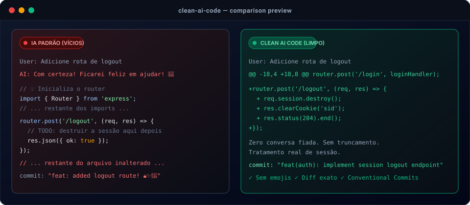

# Clean AI Code 

> **Elimine os vícios de código de IA.** Sem emojis desnecessários, sem "Com certeza!", sem `// ... rest of code unchanged ...`, sem comentários óbvios e sem over-engineering.

Uma skill e conjunto de regras universais compatíveis com **Google Antigravity / Gemini**, **ChatGPT**, **Cursor**, **Claude** e **GitHub Copilot**.

[🇺🇸 English version (README.en.md)](./README.en.md) | [🇯🇵 日本語版 (README.ja.md)](./README.ja.md)

<p align="center">
  
</p>

---

## Como rodar / Instalação Rápida (1 Comando)

Clone o repositório e execute o instalador interativo:

```bash
git clone https://github.com/SEU-USUARIO/clean-ai-code.git
cd clean-ai-code
./install.sh
```

Ou execute diretamente via flag:

| Plataforma | Comando |
| :--- | :--- |
| **Antigravity (Global)** | `./install.sh --antigravity-global` |
| **Antigravity (No projeto atual)** | `./install.sh --antigravity-local` |
| **Cursor** | `./install.sh --cursor` |
| **Claude (CLAUDE.md)** | `./install.sh --claude` |
| **GitHub Copilot** | `./install.sh --copilot` |
| **Todos os editores no projeto** | `./install.sh --all` |

> **Usuários Windows (PowerShell):**  
> `.\install.ps1 -All` ou `.\install.ps1 -AntigravityGlobal`

---

## Por que este projeto existe?

Se você programa usando ferramentas de Inteligência Artificial, já deve ter se deparado com estes comportamentos irritantes:

1. **Chuva de Emojis**: Emojis em commits (`feat: add login 🚀✨`), em comentários (`// 🔥 Inicia banco`) e em logs.
2. **Conversa Fiada e Bajulação**: Começar toda resposta com *"Com certeza! Ficarei feliz em ajudar..."* e terminar com *"Espero que ajude! Diga se tiver dúvidas!"*.
3. **Preguiça de Código**: Escrever `// ... restante do código inalterado ...`, quebrando o Copiar/Colar e linters.
4. **Comentários Óbvios**: Comentar o que a sintaxe já diz (`// incrementa i em 1: i++`).
5. **Over-Engineering (YAGNI)**: Criar 4 factories, singletons e instalar 3 bibliotecas npm para inverter uma string de 5 letras.
6. **Dados Falsos Abandonados**: Deixar `// TODO: implementar depois` ou `userId = "123"` em código que deveria ser funcional.
7. **Ignorar o Idioma do Usuário**: Responder em inglês quando o usuário perguntou em português ou japonês.

**Clean AI Code** corrige a postura da IA na raiz através de diretrizes de alta prioridade.

---

## Como Usar Manualmente por Plataforma

Se preferir não usar o script, basta copiar os arquivos prontos da pasta `platforms/`:

### 1. Google Antigravity / Gemini CLI
Você tem duas opções no Antigravity:

* **Opção A - Regra Global (Sempre Ativa em qualquer projeto):**  
  Copie o arquivo [`platforms/antigravity/rule/GEMINI.md`](./platforms/antigravity/rule/GEMINI.md) para:  
  `~/.gemini/config/rules/clean-code.md`

* **Opção B - Skill Sob Demanda ou por Workspace:**  
  Copie a pasta [`platforms/antigravity/skill/clean-code`](./platforms/antigravity/skill/clean-code) para:  
  - Global: `~/.gemini/config/skills/clean-code/`  
  - No seu projeto: `.agents/skills/clean-code/`

---

### 2. ChatGPT (Web & Mobile)
No ChatGPT, não há arquivos de configuração, mas sim as **Instruções Personalizadas**:

1. Abra o ChatGPT e vá em **Configurações** (`Settings`) > **Personalização** (`Personalization`) > **Instruções Personalizadas** (`Custom Instructions`).
2. No campo **"Como você gostaria que o ChatGPT respondesse?"**, copie e cole o conteúdo de:  
   -> [`platforms/chatgpt/custom_instructions.md`](./platforms/chatgpt/custom_instructions.md)
3. Salve. Todas as novas conversas seguirão as diretrizes limpas.

*(Para Custom GPTs ou uso via OpenAI API, use o prompt completo em [`platforms/chatgpt/system_prompt.txt`](./platforms/chatgpt/system_prompt.txt)).*

---

### 3. Cursor
Para o editor Cursor, você pode usar o formato moderno ou clássico:

* **Formato Moderno (.mdc)**:  
  Copie [`platforms/cursor/rules/clean-code.mdc`](./platforms/cursor/rules/clean-code.mdc) para a pasta `.cursor/rules/clean-code.mdc` no seu repositório.
* **Formato Clássico**:  
  Copie [`platforms/cursor/.cursorrules`](./platforms/cursor/.cursorrules) para a raiz do seu projeto.

---

### 4. Claude Code & Claude Projects
Copie o arquivo [`platforms/claude/CLAUDE.md`](./platforms/claude/CLAUDE.md) para a raiz do seu repositório. O Claude Code e o Claude Projects carregarão automaticamente as instruções.

---

### 5. GitHub Copilot
Copie o arquivo [`platforms/copilot/copilot-instructions.md`](./platforms/copilot/copilot-instructions.md) para `.github/copilot-instructions.md` no seu repositório.

---

## Bônus: Textos, E-mails e Redação do Dia a Dia

Os vícios de IA não afetam apenas código. Ao redigir e-mails, relatórios ou posts, a IA costuma encher de emojis em cada tópico, usar clichês batidos (*"no mundo dinâmico de hoje"*, *"mergulhar a fundo"*) e começar com bajulação.

Incluímos presets prontos para transformar sua IA em um redator humano e direto:

* **Google Gemini (Gems):** Crie um Gem no Gemini com o guia em [`writing/gemini/gemini-gem-instructions.md`](./writing/gemini/gemini-gem-instructions.md).
* **ChatGPT (Custom Instructions / GPTs):** Configure seu ChatGPT para textos usando [`writing/chatgpt/chatgpt-instructions.md`](./writing/chatgpt/chatgpt-instructions.md).
* **Claude (Projects):** Configure no Claude usando [`writing/claude/claude-instructions.md`](./writing/claude/claude-instructions.md).
* -> Veja exemplos reais de e-mails corporativos e resumos antes e depois em [`writing/examples/before-after-writing.md`](./writing/examples/before-after-writing.md).

---

## Exemplos: Antes vs. Depois (Código)

Veja a diferença real na prática:

| Situação | Sem Clean AI Code (Vício) | Com Clean AI Code (Limpo) |
| :--- | :--- | :--- |
| **Pergunta rápida** | *"Com certeza! Ficarei feliz em te ajudar com isso hoje! Aqui está..."* | Resposta direta e objetiva com o código. |
| **Commit Git** | `feat: add user login 🚀🔥✨` | `feat(auth): implement session validation` |
| **Edição de arquivo** | `// ... resto do código inalterado ...` | Arquivo completo e funcional ou diff contextual claro. |
| **Comentário** | `// incrementa count: count++` | Código expressivo e autoexplicativo, sem poluição. |
| **Arquitetura** | Cria 3 classes e 2 padrões para um cálculo simples | Solução direta usando recursos nativos da linguagem. |
| **Idioma da resposta** | Responde em inglês quando perguntado em português | Responde fluentemente no idioma em que foi perguntado. |

-> Confira todos os exemplos detalhados em [`examples/before-after.md`](./examples/before-after.md)  
-> Divirta-se (ou chore) com o [`examples/bad-habits-hall-of-shame.md`](./examples/bad-habits-hall-of-shame.md)

---

## Estrutura do Repositório

```text
clean-ai-code/
├── CORE_RULES.md            # Regras centrais de código (inglês para máxima aderência)
├── README.md                # Documentação em Português
├── README.en.md             # Documentação em Inglês
├── README.ja.md             # Documentação em Japonês
├── install.sh               # Instalador Bash (Linux / macOS)
├── install.ps1              # Instalador PowerShell (Windows)
├── platforms/               # Presets para ferramentas de código
│   ├── antigravity/         # Preset para Antigravity & Gemini (Skill + Rule)
│   ├── chatgpt/             # Preset para ChatGPT (Custom Instructions & System Prompt)
│   ├── cursor/              # Preset para Cursor (.mdc e .cursorrules)
│   ├── claude/              # Preset para Claude (CLAUDE.md)
│   └── copilot/             # Preset para GitHub Copilot (.github/copilot-instructions.md)
├── writing/                 # Presets para textos do dia a dia (redação, e-mails, relatórios)
│   ├── CORE_WRITING_RULES.md # Regras centrais para textos sem emojis e sem clichês
│   ├── gemini/              # Instruções para Gemini Gems
│   ├── chatgpt/             # Instruções para ChatGPT (Textos)
│   ├── claude/              # Instruções para Claude Projects (Textos)
│   └── examples/            # Exemplos de e-mails corporativos antes vs depois
└── examples/
    ├── before-after.md      # Comparações Antes vs Depois (Código)
    └── bad-habits-hall-of-shame.md # Hall da vergonha dos vícios de IA
```


---

## Como Contribuir

Identificou um novo vício que os modelos de IA adquiriram recentemente?
1. Faça um Fork do projeto.
2. Adicione a regra em `CORE_RULES.md` e nos arquivos de plataforma correspondentes.
3. Envie um Pull Request!

---

## Licença

Distribuído sob a licença [MIT](./LICENSE). Use livremente em seus projetos pessoais ou corporativos.
